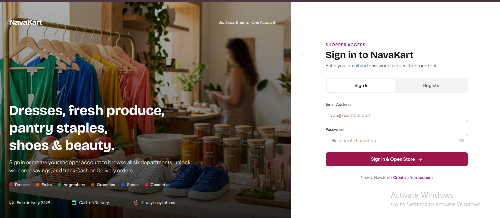
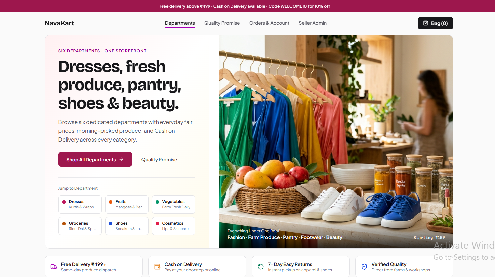
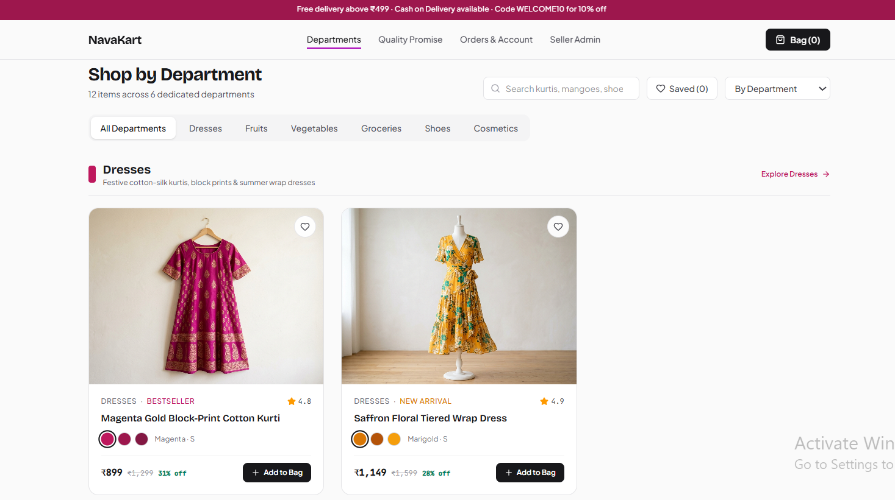
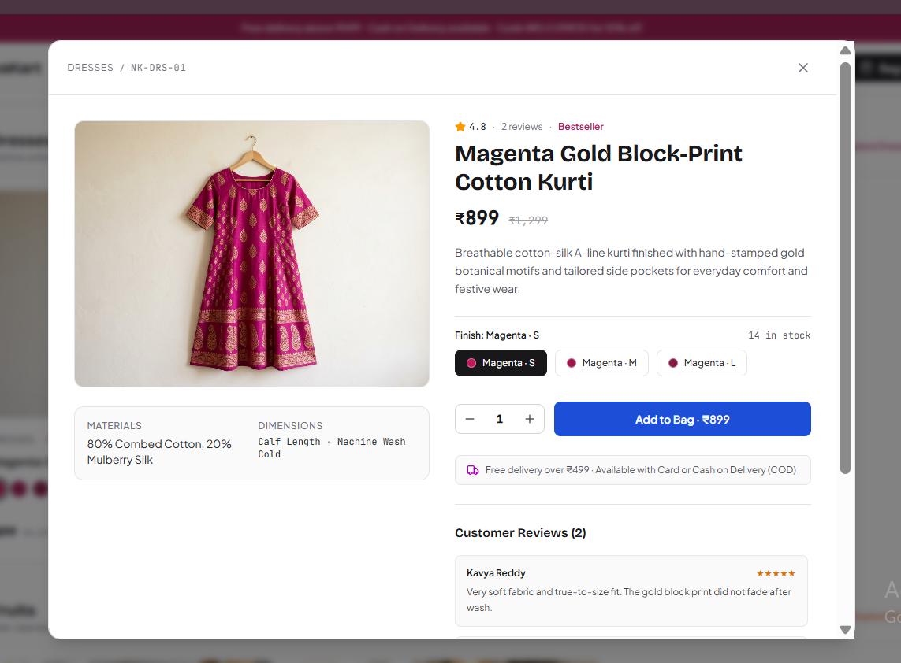
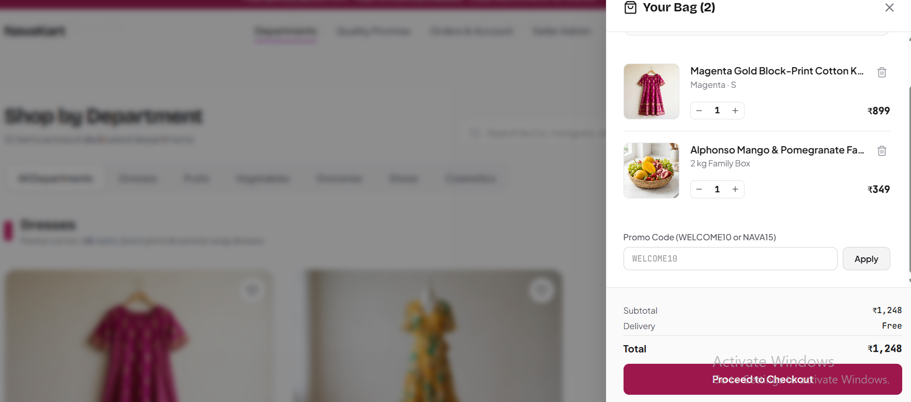
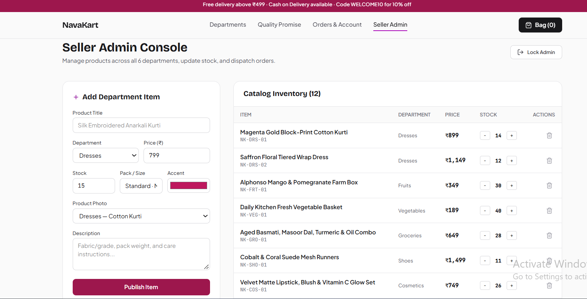

# NavaKart — Multi-Department MERN E-Commerce Marketplace

A full-stack multi-category e-commerce web application built with **MongoDB (Mongoose)**, **Express**, **React 19**, **TypeScript**, and **Tailwind CSS v4**. Designed with dedicated, color-coded shopping departments for **Dresses**, **Fruits**, **Vegetables**, **Groceries**, **Shoes**, and **Cosmetics** inside one unified storefront.

---

## Features

- **Six Separate Storefront Departments**: Browse grouped department sections (`Dresses`, `Fruits`, `Vegetables`, `Groceries`, `Shoes`, `Cosmetics`) on the home page or open any dedicated department view.
- **Smart Search, Sorting & Wishlist**: Search across product titles, descriptions, and SKUs, sort by price or buyer rating, and save favorite items.
- **Product Detail View (PDP)**: Interactive size/weight/shade variant selector with live stock counts, material/weight specifications, and verified customer reviews.
- **Bag & Checkout Drawer**: Slide-over shopping bag with live `₹499` free-delivery progress bar, promo codes (`WELCOME10`, `NAVA15`), and **Cash on Delivery (COD)** or **UPI / Card** checkout.
- **Server-Side Pricing & Stock Integrity**: Item subtotals, discounts, shipping fees, and stock decrements are calculated and validated on the Express backend.
- **Order Tracking & Customer Accounts**: Track any order by `Order Number` + `Email` or last 4 digits of your phone number, or sign in to view full order history.
- **Seller Admin Console**: Protected inventory & order fulfillment dashboard supporting new product publishing, stock updates, product deletion, and order status updates.

---

## Tech Stack

- **Frontend**: React 19, TypeScript, Vite 8, Tailwind CSS v4, Lucide Icons
- **Backend**: Node.js, Express 4, Mongoose 9
- **Database**: MongoDB (via `MONGODB_URI`), with automatic local JSON persistence (`server/data/store.json`) when running locally without a MongoDB server
- **Security**: `crypto.scrypt` password hashing with random per-user salts, timing-safe HMAC-SHA256 bearer tokens, and strict server-side input validation

---

## Project Structure

```text
├── server.ts                  # Express app entry point + Vite dev/prod static serving
├── server/
│   ├── config/db.ts           # MongoDB connection + local store fallback
│   ├── data/seed.ts           # Initial 6-department product catalog seed
│   ├── middleware/auth.ts     # scrypt hashing, HMAC session tokens, RBAC guards
│   ├── models/                # Mongoose schemas (Product, User, Order)
│   ├── routes/                # REST endpoints (products, auth, orders)
│   └── services/repository.ts # Unified data access layer
├── src/
│   ├── components/            # Storefront, department views, PDP, checkout, tracking & admin
│   ├── lib/api.ts             # Typed API client & INR formatter
│   ├── App.tsx                # Root application state & routing
│   └── index.css              # Tailwind CSS v4 + typography configuration
└── docs/screenshots/          # Add captured browser screenshots here before pushing
```

---

## Getting Started

### 1. Install Dependencies

```bash
npm install
```

### 2. Configure Environment Variables

Copy `.env.example` to `.env`:

```bash
cp .env.example .env
```

Optional variables:

- `MONGODB_URI` — MongoDB connection string. If omitted, the server automatically persists data in `server/data/store.json`.
- `ADMIN_PASSCODE` — Seller Admin passcode. If omitted on first boot, claim an initial passcode directly inside the **Seller Admin** tab.

### 3. Run Locally

```bash
npm run dev
```

Open [http://localhost:3000](http://localhost:3000) in your browser.

### 4. Production Build

```bash
npm run build
NODE_ENV=production npm start
```

---

## Screenshots

### 1. Sign In & Registration Gate


### 2. Multi-Department Hero & Quick Jump


### 3. Six Storefront Departments


### 4. Product Detail & Variant Picker


### 5. Shopping Bag & Checkout (COD / UPI)


### 6. Seller Admin Console
